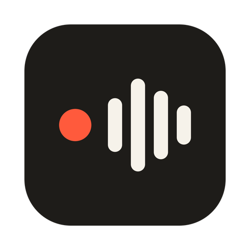

<div align="right">

🌐 **Langue** : **Français** | [English](README.md)

</div>

<div align="center">



# Parler

### Parlez. Vos mots s'écrivent là où vous tapez.

**La dictée libre et gratuite pour macOS, Windows et Linux, propulsée par l'API de transcription de votre choix.**

[](https://github.com/Synapsr/Parler/releases/latest)
[](LICENSE)
[](https://tauri.app/)

[⬇️ Télécharger](#️-télécharger) • [✨ Fonctionnalités](#-fonctionnalités) • [🔌 Services](#-services) • [🏗️ Architecture](docs/architecture.md) • [🎨 Design system](docs/design-system.md) • [🤝 Contribuer](docs/contributing.md)

</div>

---

## 💡 Parler, c'est quoi ?

Maintenez un raccourci, parlez, relâchez : Parler envoie votre voix à **Groq**, **OpenAI**, **Fireworks** ou à n'importe quel serveur **compatible Whisper**, puis écrit le texte là où se trouve votre curseur. Dans vos mails, votre éditeur de code, votre messagerie : partout.

Ni compte, ni abonnement, ni modèle à télécharger. Vous apportez votre propre clé d'API, et elle reste sur votre ordinateur.

```
   ⌥ Espace maintenu  ──►  🎙️ votre voix  ──►  ☁️ API Whisper  ──►  ✍️ texte dans l'app active
                            (WAV 16 kHz)       (Groq, OpenAI…)      (presse-papiers rétabli)
```

---

## ✨ Fonctionnalités

|            🎯 **Un raccourci**             |          ⚡ **Rapide**           |          🔒 **À vous**          |
| :----------------------------------------: | :-----------------------------: | :----------------------------: |
| Maintenez pour parler, ou appuyez pour démarrer et arrêter. | Environ une seconde avec Groq. | Votre clé, votre service. MIT. |

|        🧭 **Prise en main guidée**         |    🌍 **Toutes les langues**    |      🖥️ **Partout**       |
| :---------------------------------------: | :----------------------------: | :-----------------------: |
| Choisir un service, coller une clé, tester. | Détection automatique ou au choix. | macOS, Windows et Linux. |

- **Écrit là où vous tapez**, puis remet votre presse-papiers comme il était.
- **N'envoie jamais de silence** : sur un audio vide, Whisper invente du texte (« Sous-titres réalisés par la communauté d'Amara.org »…), donc les enregistrements vides ne quittent pas votre machine.
- **Vocabulaire** pour que noms, marques et jargon soient bien orthographiés.
- **Dictées récentes** à recopier si l'une a atterri dans la mauvaise fenêtre, et **Réessayer** quand le réseau a lâché.
- **Échap annule** une dictée en cours.
- Une **pastille** discrète en bas de l'écran montre le niveau de votre voix, sans jamais voler le focus.
- Interface en **français et en anglais**.

---

## ⬇️ Télécharger

Récupérez la dernière version sur la [page des versions](https://github.com/Synapsr/Parler/releases/latest) :

| Système | Fichier |
| --- | --- |
| macOS (Apple Silicon et Intel) | `Parler_x.y.z_universal.dmg` |
| Windows 10/11 | `Parler_x.y.z_x64-setup.exe` ou `.msi` |
| Linux | `.AppImage`, `.deb` ou `.rpm` |

Ouvrez ensuite Parler et suivez la configuration en trois étapes.

<details>
<summary><b>macOS refuse d'ouvrir l'app</b></summary>

Les versions sont notarisées quand le pipeline de publication dispose des identifiants Apple. Sinon, faites un clic droit sur **Parler.app → Ouvrir**, ou lancez :

```sh
xattr -dr com.apple.quarantine /Applications/Parler.app
```

Parler demande deux autorisations : **Micro** (pour vous entendre) et **Accessibilité** (pour coller à votre place).
</details>

<details>
<summary><b>Windows SmartScreen signale un éditeur inconnu</b></summary>

Cliquez sur **Informations complémentaires → Exécuter quand même**. Chaque version fournit un fichier `SHA256SUMS` et une [attestation de build](https://docs.github.com/actions/security-for-github-actions/using-artifact-attestations) vérifiable avec `gh attestation verify <fichier> --repo Synapsr/Parler`.
</details>

<details>
<summary><b>Linux et Wayland</b></summary>

Les raccourcis globaux fonctionnent sous X11. Sous Wayland, associez un raccourci dans les réglages de votre bureau à la commande :

```sh
parler --toggle
```

Sous Wayland, le collage passe par `wtype` ou `ydotool` s'ils sont installés.
</details>

---

## 🔌 Services

| Service | Modèle par défaut | Obtenir une clé |
| --- | --- | --- |
| **Groq** (recommandé) | `whisper-large-v3-turbo` | [console.groq.com/keys](https://console.groq.com/keys) |
| **OpenAI** | `gpt-4o-mini-transcribe` | [platform.openai.com/api-keys](https://platform.openai.com/api-keys) |
| **Fireworks** | `whisper-v3-turbo` | [app.fireworks.ai](https://app.fireworks.ai/settings/users/api-keys) |
| **Personnalisé** | au choix | Votre serveur compatible avec l'API audio d'OpenAI : [speaches](https://github.com/speaches-ai/speaches), [LocalAI](https://localai.io)… |

Tout autre modèle proposé par le service peut être saisi dans les réglages. Les tarifs et offres gratuites dépendent de chaque service.

---

## 🔐 Confidentialité

- L'audio n'est enregistré que pendant la dictée, et n'est envoyé qu'au service que vous avez choisi.
- Votre clé d'API et vos réglages restent dans un fichier local lisible par votre seul compte utilisateur.
- Les 50 dernières transcriptions sont gardées en local pour pouvoir les recopier ; vous pouvez les effacer à tout moment.
- Ni statistiques, ni télémétrie, ni serveur Parler.

---

## 🛠️ Compiler depuis les sources

Nécessite [Rust](https://rustup.rs) 1.88+, [Node.js](https://nodejs.org) 20+ et [pnpm](https://pnpm.io).

```sh
git clone https://github.com/Synapsr/Parler.git
cd Parler
pnpm install
pnpm tauri dev      # lancer en développement
pnpm tauri build    # produire un installeur pour votre système
```

Sous Linux, installez les [prérequis de Tauri](https://tauri.app/start/prerequisites/#linux) ainsi que `libasound2-dev libpulse-dev libxtst-dev libxkbcommon-dev`. Voir [docs/contributing.md](docs/contributing.md).

---

## 🙏 Remerciements

Parler s'appuie sur [Handy](https://github.com/cjpais/Handy), l'app de dictée open source de CJ Pais : la capture du micro vient de sa bibliothèque [`handy-recorder`](https://crates.io/crates/handy-recorder), et la pastille qui ne vole pas le focus ainsi que le collage adapté à la disposition du clavier en sont adaptés. Voir [THIRD_PARTY_NOTICES.md](THIRD_PARTY_NOTICES.md).

## 📄 Licence

[MIT](LICENSE) © Synapsr
