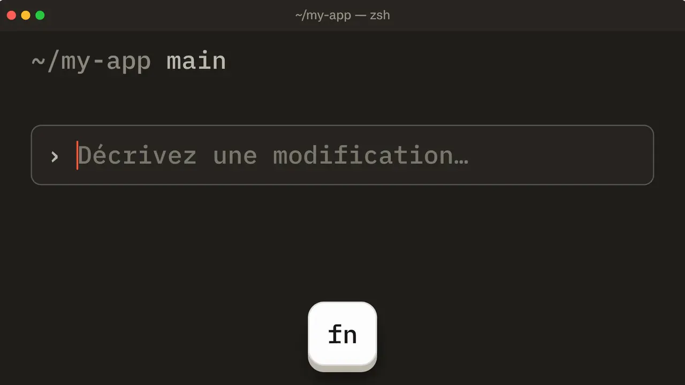

<div align="center">

<a href="https://parler.synapsr.io"></a>

# Parler

**La dictée vocale open source pour Mac, Windows et Linux.**<br />
Maintenez un raccourci, parlez, relâchez : vos mots s'écrivent dans n'importe quelle app.

[](https://github.com/Synapsr/Parler/releases)
[](https://github.com/Synapsr/Parler/actions/workflows/ci.yml)
[](LICENSE)
[](#installer)
[](https://tauri.app)
[](docs/contributing.md)

[**Site web**](https://parler.synapsr.io) · [**Télécharger**](https://github.com/Synapsr/Parler/releases) · [**Documentation**](docs/) · [**Contribuer**](docs/contributing.md) · [English](README.md)

</div>

<p align="center">
  <a href="https://parler.synapsr.io/videos/parler-open-source-fr.v1.mp4">
    
  </a>
  <br />
  <sub><a href="https://parler.synapsr.io/videos/parler-open-source-fr.v1.mp4">▶ Voir la vidéo complète, avec le son (54 s)</a></sub>
</p>

## Parler, c'est quoi ?

Parler est une app de dictée libre et gratuite pour votre ordinateur : **la saisie vocale qui marche dans toutes vos apps**, vos mails, votre messagerie, vos documents, votre navigateur ou votre éditeur de code. Maintenez un raccourci, parlez naturellement, relâchez. Parler envoie votre voix à une API de transcription compatible Whisper et écrit le texte là où se trouve votre curseur.

Vous choisissez qui transcrit : **Parler Cloud**, sans rien à configurer, ou votre propre clé d'API chez **Groq** (inscription gratuite), **OpenAI**, **Fireworks** ou **votre propre serveur**, qui reste sur votre ordinateur. Aucun modèle à télécharger, aucune télémétrie.

Vous cherchez une alternative open source à Wispr Flow, SuperWhisper ou à la dictée intégrée de votre système, qui marche pareil sous macOS, Windows et Linux ? C'est exactement ce que fait Parler.

## Comment ça marche

1. **Maintenez** <kbd>fn</kbd> sur macOS, ou <kbd>Ctrl</kbd> + <kbd>Espace</kbd> sous Windows et Linux, et parlez. Une petite pastille en bas de l'écran montre le niveau de votre voix.
2. **Relâchez.** Parler retire les silences et n'envoie que votre voix au service choisi.
3. **C'est écrit.** Le texte apparaît là où se trouve votre curseur, et votre presse-papiers est remis comme il était.

Un appui bref au lieu d'un appui long garde l'écoute ouverte jusqu'au suivant. Vous pouvez cliquer et changer de fenêtre pendant que vous parlez : le texte s'écrit là où se trouve votre curseur quand vous relâchez. Appuyez deux fois sur <kbd>Échap</kbd> pour annuler. Le raccourci se change dans les réglages.

<p align="center">
  <picture>
    <source media="(prefers-color-scheme: dark)" srcset="docs/images/home-dark.webp" />
    
  </picture>
</p>

## Fonctionnalités

| Fonctionnalité | Ce qu'elle fait |
| --- | --- |
| **Marche dans toutes les apps** | Écrit dans la fenêtre active, puis rétablit votre presse-papiers. Vous préférez coller vous-même ? Passez en copie seule. |
| **Un raccourci, trois modes** | Intelligent (maintenir pour parler, appui bref pour continuer d'écouter), Maintenir ou Basculer. Sur macOS, une seule touche comme fn ou ⌘ droite ; partout, la combinaison de votre choix. |
| **N'envoie jamais de silence** | Sur un audio vide, Whisper invente du texte (« Sous-titres réalisés par la communauté d'Amara.org »…), donc les enregistrements sans parole ne quittent pas votre machine. |
| **Vocabulaire** | Noms, marques et jargon bien orthographiés. |
| **Historique avec recherche** | Retrouvez une dictée et recopiez-la si elle a atterri dans la mauvaise fenêtre. Réessayez quand le réseau a lâché. |
| **Prise en main guidée** | Choisir un service, coller sa clé, la tester, faire sa première dictée. Environ deux minutes. |
| **Barre des menus et zone de notification** | Lancer une dictée, copier la dernière transcription, ouvrir l'historique. Peut se lancer à l'ouverture de session. |
| **Plus de 30 langues parlées** | Détection automatique, ou choisissez la vôtre pour une transcription plus rapide et plus juste. |
| **Clair ou sombre** | Ou selon votre système. Interface en 12 langues. |
| **Votre micro** | Celui du système ou celui de votre choix. Les sons peuvent être coupés. |
| **Se met à jour seul** | Les nouvelles versions s'installent entre deux dictées, et seulement si elles portent la signature du projet. |

## Services de transcription et tarifs

Parler est gratuit. Il fonctionne avec tout service compatible avec l'API audio d'OpenAI (`POST /audio/transcriptions`), et vous payez ce service directement, à ses tarifs. Parler ne prend aucune commission.

| Service | Modèle par défaut | Autres suggestions | Clé d'API |
| --- | --- | --- | --- |
| **Groq** (par défaut) | `whisper-large-v3-turbo` | `whisper-large-v3` | [console.groq.com/keys](https://console.groq.com/keys), inscription gratuite |
| **OpenAI** | `gpt-4o-mini-transcribe` | `gpt-4o-transcribe`, `whisper-1` | [platform.openai.com/api-keys](https://platform.openai.com/api-keys) |
| **Fireworks** | `whisper-v3-turbo` | `whisper-v3` | [app.fireworks.ai](https://app.fireworks.ai/settings/users/api-keys) |
| **Votre serveur** | `whisper-1` | tout modèle qu'il sert | Facultative. Compatible [speaches](https://github.com/speaches-ai/speaches), [LocalAI](https://localai.io) et autres serveurs compatibles OpenAI. |

Tout autre modèle proposé par un service peut être saisi dans les réglages, et vous pouvez changer de service à tout moment : chacun garde sa propre clé.

> [!TIP]
> **Pas envie de créer une clé d'API ? Choisissez Parler Cloud.** Sélectionnez-le à la configuration de Parler, connectez-vous une fois depuis votre navigateur, et dictez. Transcription illimitée pour l'usage normal d'une personne ([usage raisonnable](https://parler.synapsr.io/fair-use)), pour 8 € HT par mois ou 49 € HT par an, après 3 jours d'essai gratuit. Votre compte : [cloud.parler.synapsr.io](https://cloud.parler.synapsr.io). Une question : [parler@synapsr.io](mailto:parler@synapsr.io).

<p align="center">
  <picture>
    <source media="(prefers-color-scheme: dark)" srcset="docs/images/settings-dark.webp" />
    
  </picture>
</p>

## Installer

### Télécharger

| Système | Dernière version |
| --- | --- |
| macOS 11 ou plus récent (Apple Silicon et Intel) | [Parler-macOS.dmg](https://github.com/Synapsr/Parler/releases/latest/download/Parler-macOS.dmg), universel, notarisé par Apple |
| Windows 10 et 11 | [Installeur (.exe)](https://github.com/Synapsr/Parler/releases/latest/download/Parler-Windows-x64-setup.exe) ou [.msi](https://github.com/Synapsr/Parler/releases/latest/download/Parler-Windows-x64.msi) |
| Linux (x64) | [.AppImage](https://github.com/Synapsr/Parler/releases/latest/download/Parler-Linux-x86_64.AppImage), [.deb](https://github.com/Synapsr/Parler/releases/latest/download/Parler-Linux-amd64.deb) ou [.rpm](https://github.com/Synapsr/Parler/releases/latest/download/Parler-Linux-x86_64.rpm) |

Ensuite, Parler se met à jour seul : il cherche une nouvelle version au lancement puis toutes les quelques heures, et l'installe entre deux dictées. Une mise à jour doit porter la signature du projet, sinon Parler la refuse. Seul le `.rpm` fait exception : installez les nouvelles versions depuis ici. Toutes les versions sont sur la [page des versions](https://github.com/Synapsr/Parler/releases).

Les versions produites par le [workflow de publication](.github/workflows/release.yml) fournissent un fichier `SHA256SUMS` et une [attestation de build](https://docs.github.com/actions/security-for-github-actions/using-artifact-attestations) vérifiable avec `gh attestation verify <fichier> --repo Synapsr/Parler`.

<details>
<summary><b>Autorisations sur macOS</b></summary>

Parler demande deux autorisations : **Micro** (pour vous entendre) et **Accessibilité** (pour écrire le texte à votre place). Il n'écoute que pendant la dictée.

</details>

<details>
<summary><b>Avertissement Windows SmartScreen</b></summary>

Si SmartScreen signale un éditeur inconnu, cliquez sur **Informations complémentaires → Exécuter quand même**. Vous pouvez d'abord vérifier l'installeur avec `SHA256SUMS`.

</details>

<details>
<summary><b>Linux et Wayland</b></summary>

Les raccourcis globaux fonctionnent sous X11. Sous Wayland, associez un raccourci dans les réglages de votre bureau à cette commande :

```sh
parler --toggle
```

Sous Wayland, le collage passe par `wtype` ou `ydotool` si l'un des deux est installé. Sinon, le texte reste dans le presse-papiers, à vous de le coller.

</details>

### Compiler depuis les sources

Nécessite [Rust](https://rustup.rs) 1.88+, [Node.js](https://nodejs.org) 20+ et [pnpm](https://pnpm.io) 10.

```sh
git clone https://github.com/Synapsr/Parler.git
cd Parler
pnpm install
pnpm tauri dev      # lancer en développement
pnpm tauri build    # produire un installeur pour votre système
```

Sous Linux, installez aussi les [prérequis de Tauri](https://tauri.app/start/prerequisites/#linux) et `libasound2-dev libpulse-dev libxtst-dev libxkbcommon-dev`. Pour travailler sur l'interface seule, lancez `pnpm dev` et ouvrez <http://localhost:1420/preview.html> : pas besoin de compiler le Rust. Plus de détails dans [docs/contributing.md](docs/contributing.md).

## Confidentialité

- L'audio n'est enregistré que pendant la dictée et n'est envoyé qu'au service choisi. Il n'est jamais écrit sur le disque, sauf pour une dictée qui n'a pas pu être envoyée (faute de connexion, par exemple) : son audio reste sur cet ordinateur, lisible par votre seul compte utilisateur, jusqu'à son envoi ou sa suppression, 7 jours au plus.
- Les enregistrements sans parole ne sont jamais envoyés.
- Votre clé d'API et vos réglages restent dans un fichier local lisible par votre seul compte utilisateur.
- Vos transcriptions (les 5 000 dernières) restent sur votre ordinateur pour pouvoir les retrouver et les recopier. Effacez-les quand vous voulez.
- Ni statistiques, ni télémétrie. Votre audio ne va qu'au service choisi : votre fournisseur directement, ou Parler Cloud si vous l'avez choisi. Parler Cloud garde l'audio en mémoire le temps de la requête, le fait transcrire par Groq, et ne conserve ni l'audio ni le texte.
- Parler cherche les nouvelles versions sur GitHub et les télécharge depuis GitHub (les empaqueteurs peuvent le désactiver avec `PARLER_DISABLE_UPDATER=1`).
- **Réglages → À propos → Envoyer le journal** envoie au support la version de Parler, votre système et son journal technique, seulement quand vous le demandez. Parler Cloud le transmet par e-mail et ne garde rien.
- Ce que le service fait de votre audio dépend de sa propre politique. Avec votre propre serveur, rien ne sort de votre réseau.

## Langues

**Parlées :** Parler détecte la langue dans laquelle vous parlez, ou vous en choisissez une parmi 31 : anglais, français, espagnol, allemand, italien, portugais, néerlandais, breton, catalan, basque, polonais, tchèque, roumain, hongrois, suédois, danois, norvégien, finnois, grec, turc, ukrainien, russe, arabe, hébreu, hindi, indonésien, vietnamien, thaï, chinois, japonais et coréen. La qualité dépend du service et du modèle.

**Interface :** anglais, français, espagnol, allemand, italien, portugais, néerlandais, polonais, turc, japonais, chinois et coréen. [Ajoutez la vôtre](docs/contributing.md#conventions).

## Questions fréquentes

<details>
<summary><b>Parler est-il gratuit ?</b></summary>

Oui. L'app est libre et gratuite, sous licence MIT. Vous la reliez à votre propre compte chez un service de transcription et vous payez ce service directement, à ses tarifs ; Groq propose une inscription gratuite pour démarrer. Parler Cloud est l'offre payante facultative pour ceux qui préfèrent ne pas gérer de clé d'API : 8 € HT par mois ou 49 € HT par an, après 3 jours d'essai gratuit.

</details>

<details>
<summary><b>Quel service choisir ?</b></summary>

Parler Cloud si vous ne voulez rien configurer. Avec votre propre clé, Groq est le choix par défaut : il fait tourner Whisper large-v3 turbo, répond vite et propose une inscription gratuite. Prenez OpenAI ou Fireworks si vous y avez déjà un compte, ou votre propre serveur pour tout maîtriser. Vous pouvez en changer à tout moment dans les réglages.

</details>

<details>
<summary><b>Est-ce que ça marche hors ligne ?</b></summary>

Pas tout seul : la transcription se fait chez le service choisi, il faut donc une connexion internet. Si vous faites tourner un serveur compatible OpenAI sur votre réseau (speaches, LocalAI…), Parler fonctionne sans internet.

</details>

<details>
<summary><b>Quelle différence avec Wispr Flow, SuperWhisper ou la dictée de macOS ?</b></summary>

Même idée : parler plutôt que taper, dans n'importe quelle app. L'approche de Parler : le code est ouvert (MIT), l'app est gratuite, elle tourne sous macOS, Windows et Linux, et vous choisissez qui transcrit votre voix, de Groq, OpenAI ou Fireworks à un serveur que vous hébergez. Parler écrit ce que vous avez dit ; il ne le réécrit pas.

</details>

<details>
<summary><b>Ma voix est-elle conservée ou utilisée pour entraîner des modèles ?</b></summary>

Parler ne conserve pas votre audio, sauf celui d'une dictée qui n'a pas pu être envoyée : il attend sur votre ordinateur jusqu'à son envoi ou sa suppression, 7 jours au plus. Pour le reste, Parler ne garde que le texte de vos dictées, que vous pouvez effacer à tout moment. Ce que le service fait de l'audio dépend de sa propre politique : lisez-la avant de choisir.

</details>

## Contribuer

Signalements de bugs, traductions et pull requests sont bienvenus. Commencez par [docs/contributing.md](docs/contributing.md) (installation, vérifications, conventions), puis lisez l'[architecture](docs/architecture.md) et le [design system](docs/design-system.md). Parler veut rester simple et évident : avant d'ajouter un réglage, demandez-vous si un meilleur choix par défaut suffirait.

- [Signaler un bug](https://github.com/Synapsr/Parler/issues/new?template=bug_report.yml)
- [Proposer une amélioration](https://github.com/Synapsr/Parler/issues/new?template=feature_request.yml)
- Une faille de sécurité ? Voir [SECURITY.md](SECURITY.md).
- Pour tout le reste : [parler@synapsr.io](mailto:parler@synapsr.io)

Si Parler vous fait gagner du temps, une étoile aide d'autres personnes à le trouver.

## Remerciements

Parler s'appuie sur [Handy](https://github.com/cjpais/Handy), l'app de dictée open source de CJ Pais : la capture du micro vient de sa bibliothèque [`handy-recorder`](https://crates.io/crates/handy-recorder), et la pastille qui ne vole pas le focus ainsi que le collage adapté à la disposition du clavier en sont adaptés. Voir [THIRD_PARTY_NOTICES.md](THIRD_PARTY_NOTICES.md).

## Licence

[MIT](LICENSE) © Synapsr
