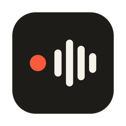
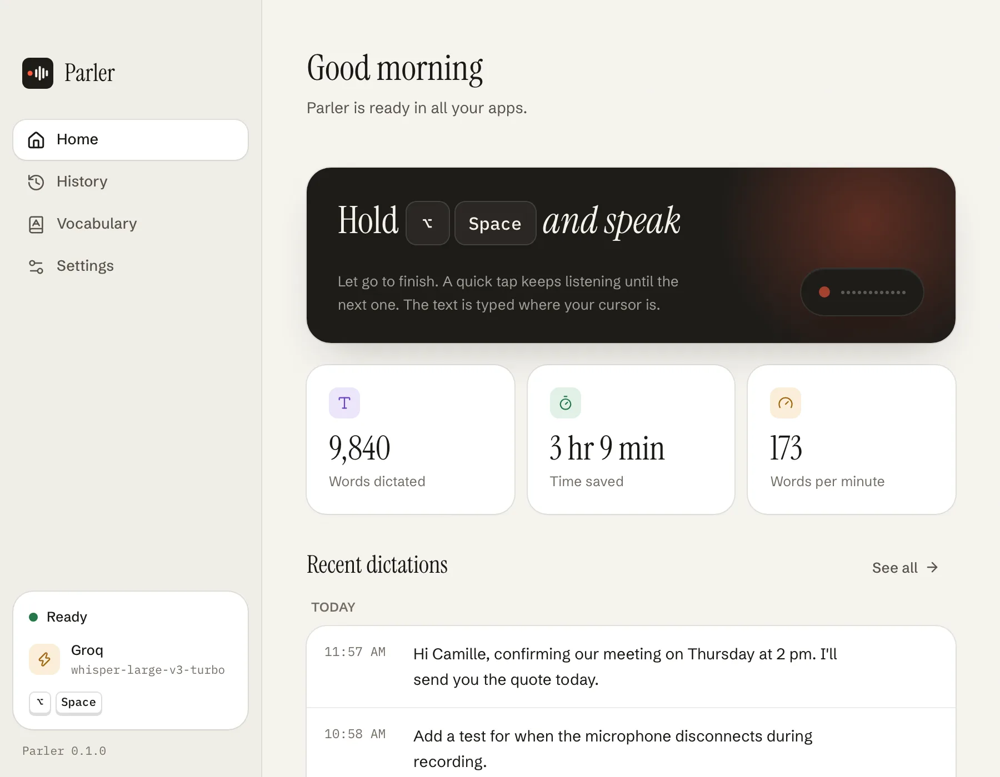
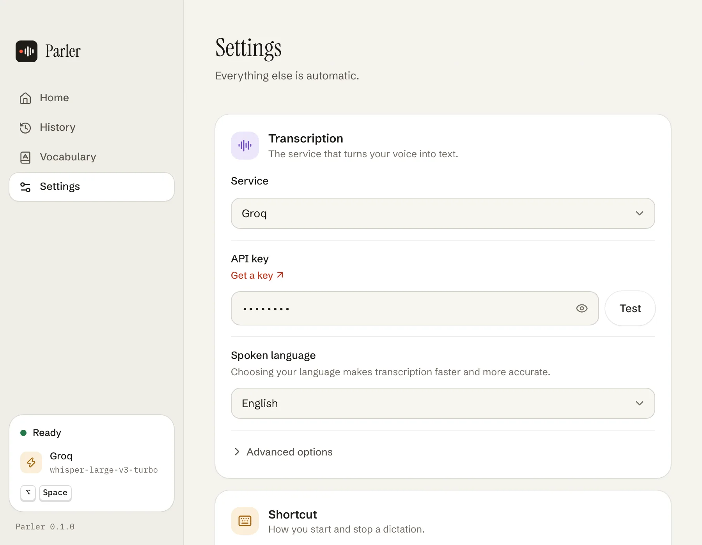

<div align="center">

<a href="https://parler.synapsr.io"></a>

# Parler

**Open-source voice dictation for Mac, Windows and Linux.**<br />
Hold a shortcut, speak, let go: your words are typed in any app.

[](https://github.com/Synapsr/Parler/releases)
[](https://github.com/Synapsr/Parler/actions/workflows/ci.yml)
[](LICENSE)
[](#install)
[](https://tauri.app)
[](docs/contributing.md)

[**Website**](https://parler.synapsr.io) · [**Download**](https://github.com/Synapsr/Parler/releases) · [**Docs**](docs/) · [**Contributing**](docs/contributing.md) · [Français](README.fr.md)

</div>

<p align="center">
  <picture>
    <source media="(prefers-color-scheme: dark)" srcset="docs/images/home-dark.webp" />
    
  </picture>
</p>

## What is Parler?

Parler is a free, open-source dictation app for your desktop: **voice typing that works in every app**, whether it's your email, chat, documents, browser or code editor. Hold a shortcut, speak naturally, let go. Parler sends your speech to a Whisper-compatible speech-to-text API and types the text where your cursor is.

You choose who transcribes: **Parler Cloud**, with nothing to set up, or your own API key at **Groq** (free sign-up), **OpenAI**, **Fireworks** or **your own server**, which stays on your computer. No model to download, no telemetry.

Looking for an open-source alternative to Wispr Flow, SuperWhisper or your system's built-in dictation, one that works the same on macOS, Windows and Linux? That's what Parler is for.

## How it works

1. **Hold** <kbd>fn</kbd> on macOS, or <kbd>Ctrl</kbd> + <kbd>Space</kbd> on Windows and Linux, and speak. A small pill at the bottom of the screen shows your voice level.
2. **Let go.** Parler trims the silence and sends only your speech to the service you picked.
3. **Done.** The text is typed where your cursor is, and your clipboard is put back the way it was.

A quick tap instead of a hold keeps listening until your next press. You can click and switch windows while you speak: the text goes where your cursor is when you let go. Press <kbd>Esc</kbd> twice to cancel. You can change the shortcut in Settings.

## Features

| Feature | What it does |
| --- | --- |
| **Works in any app** | Types into the focused window, then restores your clipboard. Prefer to paste yourself? Switch to copy-only. |
| **One shortcut, three modes** | Smart (hold to talk, tap to keep listening), hold, or toggle. On macOS, a single key such as fn or right ⌘; anywhere, your own key combination. |
| **Never sends silence** | Whisper models invent text on silent audio ("Thank you."), so recordings without speech never leave your machine. |
| **Vocabulary hints** | Names, brands and jargon come out spelled right. |
| **Searchable history** | Find any dictation and copy it again, for when it landed in the wrong window. Retry when the network failed. |
| **Guided setup** | Pick a service, paste your key, test it, try your first dictation. About two minutes. |
| **Menu bar and tray** | Start a dictation, copy the last transcript or open the history. Can start at login. |
| **30+ spoken languages** | Auto-detect, or pick yours for faster, more accurate results. |
| **Light or dark** | Or follow your system. The interface speaks 12 languages. |
| **Your microphone** | Use the system default or pick one. Sound cues can be turned off. |
| **Updates itself** | New versions install between two dictations, and only when signed by the project. |

## Speech-to-text providers and pricing

Parler is free. It works with any service that speaks the OpenAI audio API (`POST /audio/transcriptions`), and you pay that service directly, at its own rates. Parler takes no cut.

| Provider | Default model | Also suggested | API key |
| --- | --- | --- | --- |
| **Groq** (default) | `whisper-large-v3-turbo` | `whisper-large-v3` | [console.groq.com/keys](https://console.groq.com/keys), free sign-up |
| **OpenAI** | `gpt-4o-mini-transcribe` | `gpt-4o-transcribe`, `whisper-1` | [platform.openai.com/api-keys](https://platform.openai.com/api-keys) |
| **Fireworks** | `whisper-v3-turbo` | `whisper-v3` | [app.fireworks.ai](https://app.fireworks.ai/settings/users/api-keys) |
| **Your own server** | `whisper-1` | any model it serves | Optional. Works with [speaches](https://github.com/speaches-ai/speaches), [LocalAI](https://localai.io) and other OpenAI-compatible servers. |

You can type any other model a provider serves in Settings, and switch providers at any time: each one keeps its own key.

> [!TIP]
> **Rather not create an API key? Choose Parler Cloud.** Pick it when you set up Parler, sign in once from your browser, and dictate. Unlimited transcription for one person's normal use ([fair use](https://parler.synapsr.io/fair-use)), for €8 a month or €49 a year, excluding VAT, after a 3-day free trial. Your account: [cloud.parler.synapsr.io](https://cloud.parler.synapsr.io). Questions: [parler@synapsr.io](mailto:parler@synapsr.io).

<p align="center">
  <picture>
    <source media="(prefers-color-scheme: dark)" srcset="docs/images/settings-dark.webp" />
    
  </picture>
</p>

## Install

### Download

| Platform | Latest version |
| --- | --- |
| macOS 11 or later (Apple Silicon and Intel) | [Parler-macOS.dmg](https://github.com/Synapsr/Parler/releases/latest/download/Parler-macOS.dmg), universal, notarized by Apple |
| Windows 10 and 11 | [Installer (.exe)](https://github.com/Synapsr/Parler/releases/latest/download/Parler-Windows-x64-setup.exe) or [.msi](https://github.com/Synapsr/Parler/releases/latest/download/Parler-Windows-x64.msi) |
| Linux (x64) | [.AppImage](https://github.com/Synapsr/Parler/releases/latest/download/Parler-Linux-x86_64.AppImage), [.deb](https://github.com/Synapsr/Parler/releases/latest/download/Parler-Linux-amd64.deb) or [.rpm](https://github.com/Synapsr/Parler/releases/latest/download/Parler-Linux-x86_64.rpm) |

Parler then updates itself: it checks for a new version at launch and every few hours, and installs it between two dictations. Updates must carry the project's signature, or Parler refuses them. The `.rpm` is the exception: install new versions from here. Every version is on the [Releases page](https://github.com/Synapsr/Parler/releases).

Releases built by the [release workflow](.github/workflows/release.yml) come with a `SHA256SUMS` file and a [build attestation](https://docs.github.com/actions/security-for-github-actions/using-artifact-attestations) you can check with `gh attestation verify <file> --repo Synapsr/Parler`.

<details>
<summary><b>macOS permissions</b></summary>

Parler asks for **Microphone** (to hear you) and **Accessibility** (to type the text for you). It only listens while you dictate.

</details>

<details>
<summary><b>Windows SmartScreen warning</b></summary>

If SmartScreen warns about an unknown publisher, click **More info → Run anyway**. You can check the installer against `SHA256SUMS` first.

</details>

<details>
<summary><b>Linux and Wayland</b></summary>

Global shortcuts work on X11. On Wayland, bind a shortcut in your desktop settings to this command:

```sh
parler --toggle
```

Pasting on Wayland uses `wtype` or `ydotool` when one of them is installed. Otherwise, the text stays on your clipboard for you to paste.

</details>

### Build from source

Requires [Rust](https://rustup.rs) 1.88+, [Node.js](https://nodejs.org) 20+ and [pnpm](https://pnpm.io) 10.

```sh
git clone https://github.com/Synapsr/Parler.git
cd Parler
pnpm install
pnpm tauri dev      # run in development
pnpm tauri build    # build an installer for your platform
```

On Linux, also install the [Tauri prerequisites](https://tauri.app/start/prerequisites/#linux) and `libasound2-dev libpulse-dev libxtst-dev libxkbcommon-dev`. To work on the interface alone, run `pnpm dev` and open <http://localhost:1420/preview.html>: no Rust build needed. More in [docs/contributing.md](docs/contributing.md).

## Privacy

- Audio is recorded only while you dictate and sent only to the provider you picked. It is never written to disk.
- Recordings without speech are never sent.
- Your API key and settings live in a local file that only your user account can read.
- Your transcripts (the last 5,000) stay on your computer so you can search and copy them again. Clear them anytime.
- No analytics, no telemetry. Your audio goes only to the service you picked: your provider directly, or Parler Cloud if you chose it. Parler Cloud keeps the audio in memory for the length of the request, transcribes it with Groq, and stores neither the audio nor the text.
- Parler checks GitHub for new versions and downloads them from there (packagers can turn that off with `PARLER_DISABLE_UPDATER=1`).
- **Settings → About → Send the log** sends support Parler's version, your system and its technical log, only when you ask. Parler Cloud forwards it by email and keeps nothing.
- What a provider does with your audio is set by its own policy. With your own server, nothing leaves your network.

## Languages

**Spoken:** Parler detects the language you speak, or you can pick one of 31: English, French, Spanish, German, Italian, Portuguese, Dutch, Breton, Catalan, Basque, Polish, Czech, Romanian, Hungarian, Swedish, Danish, Norwegian, Finnish, Greek, Turkish, Ukrainian, Russian, Arabic, Hebrew, Hindi, Indonesian, Vietnamese, Thai, Chinese, Japanese and Korean. Accuracy depends on the provider and model.

**Interface:** English, French, Spanish, German, Italian, Portuguese, Dutch, Polish, Turkish, Japanese, Chinese and Korean. [Add yours](docs/contributing.md#conventions).

## FAQ

<details>
<summary><b>Is Parler free?</b></summary>

Yes. The app is free and open source under the MIT licence. You connect it to your own account at a speech-to-text service and pay that service directly, at its own rates; Groq offers free sign-up to get you started. Parler Cloud is the optional paid plan for people who'd rather not manage an API key: €8 a month or €49 a year, excluding VAT, after a 3-day free trial.

</details>

<details>
<summary><b>Which provider should I choose?</b></summary>

Parler Cloud if you want nothing to set up. With your own key, Groq is the default: it runs Whisper large-v3 turbo, answers fast and has free sign-up. Pick OpenAI or Fireworks if you already have an account there, or your own server for full control. You can switch at any time in Settings.

</details>

<details>
<summary><b>Does it work offline?</b></summary>

Not on its own: transcription happens at the service you chose, so you need an internet connection. If you run an OpenAI-compatible server on your own network (speaches, LocalAI…), Parler works without the internet.

</details>

<details>
<summary><b>How is it different from Wispr Flow, SuperWhisper or macOS Dictation?</b></summary>

Same idea: talk instead of type, in any app. Parler's take: the code is open (MIT), the app is free, it runs on macOS, Windows and Linux, and you choose who transcribes your voice, from Groq, OpenAI or Fireworks to a server you run yourself. Parler types what you said; it doesn't rewrite it.

</details>

<details>
<summary><b>Is my voice stored or used to train models?</b></summary>

Parler never saves your audio. On your computer it keeps only the text of your dictations, which you can clear at any time. What the provider does with the audio depends on its own policy, so give it a read before you choose.

</details>

## Contributing

Bug reports, translations and pull requests are welcome. Start with [docs/contributing.md](docs/contributing.md) (setup, checks, conventions), then read the [architecture](docs/architecture.md) and the [design system](docs/design-system.md). Parler aims to stay small and obvious: before adding a setting, ask whether a better default would do.

- [Report a bug](https://github.com/Synapsr/Parler/issues/new?template=bug_report.yml)
- [Suggest an improvement](https://github.com/Synapsr/Parler/issues/new?template=feature_request.yml)
- Found a security issue? See [SECURITY.md](SECURITY.md).
- Anything else: [parler@synapsr.io](mailto:parler@synapsr.io)

If Parler saves you some typing, a star helps other people find it.

## Credits

Parler stands on [Handy](https://github.com/cjpais/Handy), the open-source dictation app by CJ Pais: microphone capture comes from its [`handy-recorder`](https://crates.io/crates/handy-recorder) crate, and the focus-safe overlay and keyboard-layout-aware paste are adapted from it. See [THIRD_PARTY_NOTICES.md](THIRD_PARTY_NOTICES.md).

## License

[MIT](LICENSE) © Synapsr
